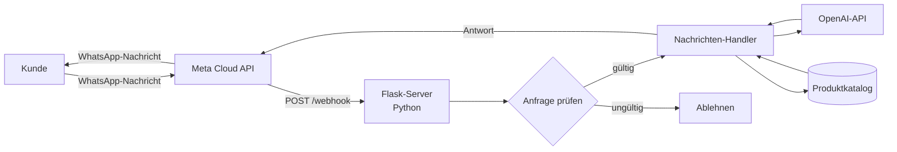

<div align="center">

# WhatsApp-KI-Assistent

**Ein interaktiver WhatsApp-Bot auf Basis der Meta Cloud API, der OpenAI nutzt, um Antworten im Gespräch zu erzeugen — das konversationelle Frontend für [Velo.Stor](https://velo-stor.netlify.app/).**

[**🔗 Begleitprojekt — Velo.Stor**](https://github.com/El-Tousy/velo.Store) · [**🇬🇧 English**](README.md)


</div>

---

## Inhaltsverzeichnis

- [Überblick](#überblick)
- [Funktionen](#funktionen)
- [Architektur](#architektur)
- [Tech-Stack](#tech-stack)
- [Projektstruktur](#projektstruktur)
- [Erste Schritte](#erste-schritte)
- [Umgebungsvariablen](#umgebungsvariablen)
- [API-Endpunkte](#api-endpunkte)
- [Tests](#tests)
- [Bereitstellung](#bereitstellung)
- [Technische Herausforderungen und Erkenntnisse](#technische-herausforderungen-und-erkenntnisse)
- [Roadmap](#roadmap)
- [Verwandtes Projekt](#verwandtes-projekt)
- [Autor](#autor)
- [Lizenz](#lizenz)

---

## Überblick

Dieses Projekt ist ein Webhook-Server, der WhatsApp in ein konversationelles Schaufenster verwandelt. Er empfängt Kundennachrichten über die **Meta WhatsApp Cloud API**, interpretiert sie mit der **OpenAI-API** und antwortet automatisch — auf Basis desselben Produktkatalogs wie die Website [Velo.Stor](https://github.com/El-Tousy/velo.Store).

Ziel ist es, dass Kunden direkt in einem WhatsApp-Chat nach Fahrrädern, E-Bikes oder Rollern fragen können — ohne App-Installation und ohne Website-Besuch. Das entspricht der Art, wie kleine Unternehmen tatsächlich verkaufen, in Märkten, in denen WhatsApp der wichtigste Handelskanal ist.

---

## Funktionen

- **Webhook-Verifizierung** — verarbeitet den `GET /webhook`-Handshake von Meta (`hub.challenge` / `hub.verify_token`)
- **Verarbeitung eingehender Nachrichten** — empfängt und parst `POST /webhook`-Payloads der Meta Cloud API
- **KI-generierte Antworten** — Kundennachrichten werden an die OpenAI-API gesendet, die eine Antwort in natürlicher Sprache auf Grundlage des Produktkatalogs erzeugt
- **Gemeinsamer Katalog** — die Antworten basieren auf denselben Produktdaten wie die Velo.Stor-Website, sodass beide Frontends konsistent bleiben
- **Signatur- / Token-Prüfung** — validiert eingehende Anfragen, bevor sie verarbeitet werden
- **Strukturiertes Logging** — Anfrage- und Fehlerprotokolle zur Fehlersuche bei der Webhook-Zustellung

---

## Architektur



Meta leitet jede eingehende WhatsApp-Nachricht an den Webhook dieses Servers weiter. Der Server prüft die Anfrage, erstellt einen Prompt, der die Nachricht des Kunden mit relevanten Katalogdaten kombiniert, sendet ihn an die OpenAI-API und gibt die erzeugte Antwort über die Meta Cloud API an den Kunden zurück — mit demselben Katalog, den auch die Website [Velo.Stor](https://github.com/El-Tousy/velo.Store) anzeigt.

---

## Tech-Stack

| Schicht | Technologie | Warum |
|---|---|---|
| Sprache | Python 3.11+ | Gut lesbar, starkes Ökosystem für API-Arbeit |
| Web-Framework | Flask | Leichtgewichtiger Webhook-Server ohne unnötigen Overhead |
| Messaging | Meta WhatsApp Cloud API | Offiziell, kein Risiko durch WhatsApp-Automatisierung von Drittanbietern |
| KI-Schicht | OpenAI-API | Verstehen natürlicher Sprache und Erzeugen von Antworten |
| Tests | pytest | Einfache, gut lesbare Unit-Tests |
| Versionierung | Git & GitHub | Versionskontrolle und Zusammenarbeit |

---

## Projektstruktur

```
whatsapp-bot/
│
├── webhook.py                 # Flask-Server: Webhook-Verifizierung und Nachrichtenverarbeitung
├── utils.py                   # Hilfsfunktionen
├── update_excel_realtime.py   # Skript, das die Produktdaten in Echtzeit aktualisiert
├── test_utils.py              # Unit-Tests
├── requirements.txt           # Python-Abhängigkeiten
├── screenshots/               # Screenshots des Bots im Einsatz
├── LICENSE
├── README.md
└── README.de.md
```

---

## Erste Schritte

### Voraussetzungen

- Python 3.11 oder neuer
- Ein [Meta-Developer](https://developers.facebook.com/)-Konto mit einer konfigurierten WhatsApp-Business-App
- Ein Schlüssel für die [OpenAI-API](https://platform.openai.com/)
- `pip` und optional ein Tool für virtuelle Umgebungen (`venv`, `poetry` usw.)

### Installation

```bash
git clone https://github.com/El-Tousy/whatsapp-bot.git
cd whatsapp-bot

python -m venv venv
source venv/bin/activate   # Windows: venv\Scripts\activate

pip install -r requirements.txt
```

### Konfiguration

Erstelle im Projektstamm eine `.env`-Datei und trage die Variablen ein, die unter [Umgebungsvariablen](#umgebungsvariablen) beschrieben sind.

### Lokal ausführen

```bash
python webhook.py
```

Um während der lokalen Entwicklung echte WhatsApp-Nachrichten zu empfangen, mache deinen lokalen Server über einen Tunnel erreichbar (z. B. `ngrok http 5000`) und trage die resultierende HTTPS-URL im Meta-Developer-Dashboard als Callback-URL des Webhooks ein.

---

## Umgebungsvariablen

| Variable | Beschreibung |
|---|---|
| `WHATSAPP_TOKEN` | Zugriffstoken für die Meta Cloud API (System-User-Token) |
| `PHONE_NUMBER_ID` | ID der WhatsApp-Business-Telefonnummer, die Nachrichten sendet und empfängt |
| `VERIFY_TOKEN` | Frei gewählte Zeichenfolge; muss mit dem in der Meta-Webhook-Konfiguration eingetragenen Wert übereinstimmen |
| `APP_SECRET` | App-Secret zur Überprüfung der Signatur von Metas Anfragen |
| `OPENAI_API_KEY` | API-Schlüssel für die OpenAI-API |
| `PORT` | Port, auf dem der Flask-Server lauscht (Standard `5000`) |

Die `.env`-Datei enthält Geheimnisse und darf niemals in das Repository committet werden.

---

## API-Endpunkte

| Methode | Pfad | Beschreibung |
|---|---|---|
| `GET` | `/webhook` | Einmaliger Verifizierungs-Handshake, den Meta bei der Registrierung des Webhooks verwendet |
| `POST` | `/webhook` | Empfängt eingehende WhatsApp-Nachrichten und löst den Antwortablauf aus |

---

## Tests

```bash
pytest
```

Die Unit-Tests in `test_utils.py` prüfen die Hilfsfunktionen isoliert und sind daher nicht auf echte Meta- oder OpenAI-Zugangsdaten angewiesen.

---

## Bereitstellung

Der Bot benötigt eine öffentlich erreichbare HTTPS-URL, damit Meta Webhook-Ereignisse an ihn zustellen kann. Jeder Hosting-Anbieter, der eine Python-/Flask-Anwendung ausführen kann, ist geeignet.

1. Stelle die Anwendung bereit und installiere die Abhängigkeiten aus `requirements.txt`.
2. Setze die oben aufgeführten Umgebungsvariablen im Dashboard des Hosting-Anbieters.
3. Trage die öffentliche URL (mit Endung `/webhook`) im Meta-Developer-Dashboard unter **WhatsApp → Configuration** ein, mit demselben `VERIFY_TOKEN`.

Für die lokale Entwicklung ersetzt ein Tunnel wie `ngrok` die Schritte 1 und 2.

---

## Technische Herausforderungen und Erkenntnisse

- **Metas Webhook-Verifizierungs-Handshake.** Der Challenge-/Response-Ablauf von `GET /webhook` sowie die Signaturprüfung (`X-Hub-Signature-256`) bei jedem `POST` müssen korrekt implementiert sein, sonst stellt Meta Nachrichten stillschweigend nicht mehr zu — es wird dem Entwickler keine ausführliche Fehlermeldung zurückgegeben.
- **Prompting für fundierte Antworten.** Die OpenAI-API dazu zu bringen, aus dem tatsächlichen Produktkatalog zu antworten, statt plausibel klingende, aber falsche Details zu erfinden, erforderte mehr Prompt-Iterationen als der Integrationscode selbst.
- **Eine gemeinsame Wahrheitsquelle mit der Website.** Den Katalog des Bots und den der Velo.Stor-Website synchron zu halten, ist die wichtigste Entwurfsbeschränkung des gesamten Systems aus zwei Repositories.
- **Latenz innerhalb des Webhook-Zeitfensters.** Der Aufruf der OpenAI-API, während Meta auf eine Antwort wartet, bedeutet, dass der Handler schnell bleiben und Fehler sauber abfangen muss — andernfalls wiederholt Meta die Zustellung, und der Kunde erhält möglicherweise doppelte Antworten.

---

## Roadmap

- [x] Webhook-Verifizierung und Nachrichtenverarbeitung
- [x] Von OpenAI generierte Antworten
- [x] Gemeinsamer Katalog mit dem Velo.Stor-Shop
- [ ] CI-Pipeline mit Lint und Tests bei jedem Push
- [ ] Gesprächsverlauf / Kontext pro Kunde
- [ ] Übergabe an einen Menschen bei Anfragen, die der Bot nicht beantworten kann
- [ ] Strukturierte Abfragen zu Bestellungen und Status
- [ ] Testabdeckung erweitern

---

## Verwandtes Projekt

**[Velo.Stor](https://github.com/El-Tousy/velo.Store)** — die arabische E-Commerce-Website mit RTL-Layout, mit der dieser Bot seinen Katalog teilt.

---

## Autor

**El-Tousy** — Informatikstudentin, Marokko

[](https://github.com/El-Tousy)
[](mailto:leilaeltousy@gmail.com)

---

## Lizenz

Veröffentlicht unter der MIT-Lizenz. Siehe [LICENSE](LICENSE) für Details.

---

<div align="center">

⭐ Wenn dir dieses Projekt nützlich erscheint, hinterlasse gerne einen Stern.

</div>
